# Battery Intelligence Platform (BIP)

## Industrial Embedded Intelligence Framework for Battery Management Systems & Cross-Chemistry Validation Study

The Battery Intelligence Platform (BIP) is an open-source, industrial-grade framework designed to bring advanced intelligence to Battery Management Systems (BMS). It integrates battery physics, electrochemical intelligence, digital signal processing, dynamic ripple detrending, and TinyML techniques directly into embedded microcontrollers (such as STM32).

---

## Research Study Highlights: Physics-Motivated Dynamic Signatures across LFP, NMC, & LCO

> [!IMPORTANT]
> **Manuscript Title**: *Cross-Chemistry Investigation of Physics-Motivated Dynamic Battery Signatures for State-of-Health and Remaining-Useful-Life Estimation*
>
> **Core Scientific Discovery**: Dynamic response features and polynomial detrending residuals track battery degradation across **LFP (Severson), NMC (Oxford), and LCO (NASA Ames)** chemistries. However, **feature transferability is heterogeneous**, and the response direction of normalized ripple is **chemistry-dependent** ($F = 6364.57, p < 0.0001$).

### Key Research Contributions

1. **Multi-Chemistry Dynamic Signatures**: Demonstrated that dynamic voltage residuals track capacity loss across LFP, NMC, and LCO chemistries.
2. **Feature Transferability Hierarchy**: Proved that feature transferability varies by descriptor. For SOH transfer across chemistries, `voltage_kurtosis` is the top individual feature ($RMSE = 0.072$); for RUL transfer, `fft_energy` ranks 2nd overall ($RMSE = 2064$ cycles), substantially outperforming raw cycle count ($RMSE = 4420$ cycles).
3. **Chemistry-Dependent Sign Reversal Mechanics**: Statistically validated that the relationship between normalized ripple and capacity is **negative** in LFP ($r = -0.69$) and LCO ($r = -0.97$), but **positive** in NMC ($r = +0.95$). Interaction ANOVA proves this sign reversal is statistically significant ($p < 0.0001$).
4. **Right-Censored RUL Transfer Protocol**: Identified that Severson LFP cells never reached 80% SOH ($eol\_observed = 0$), establishing a strict right-censoring protocol ($rul = \text{NaN}$) that restricts supervised RUL transfer to observed EOL chemistries (NMC $\leftrightarrow$ LCO).
5. **Modeling Strategy Benchmark**: Compared Global, Chemistry-Specific, and Shared + Calibrated modeling paradigms using GroupKFold cell-level splits, proving that Chemistry-Specific models achieve optimal within-chemistry accuracy ($SOH\ RMSE \le 0.0285$), while Global models maintain competitive performance without per-chemistry re-tuning.

---

## Cross-Chemistry Experimental Results & Figures

### 1. Cell Correlation Audit (Degree 2 Detrending)

All correlation metrics use the canonical first-cycle RMS normalization convention (`r_norm_firstcyc`):

| Chemistry | Dataset | Cell Count | Mean Signed $r$ | Mean Absolute $\vert r \vert$ | Correlation Sign | Censored EOL |
| --- | --- | ---: | ---: | ---: | --- | --- |
| **LFP** | Severson (Batch 1) | 8 | −0.6893 | 0.6893 | Negative | 100% Censored ($SOH > 0.80$) |
| **LCO** | NASA Ames | 4 | −0.9674 | 0.9674 | Negative | 0% Censored (Reached EOL) |
| **NMC** | Oxford | 8 | +0.9481 | 0.9481 | Positive | 0% Censored (Reached EOL) |

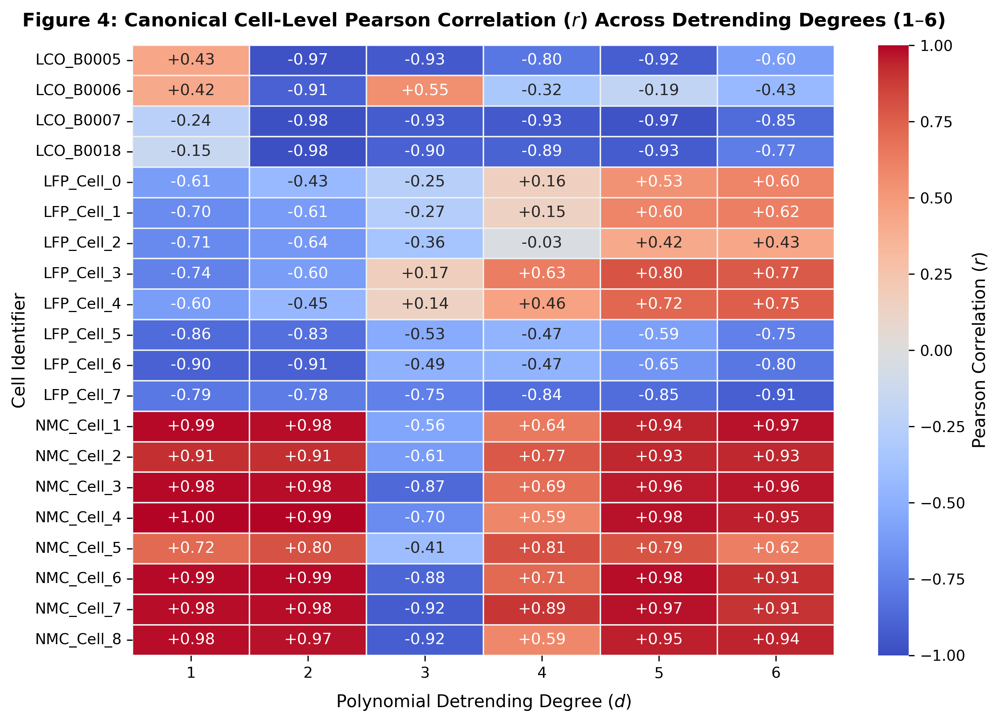

---

### 2. Experiment 1 & 2: Signed $r$ vs. Absolute $|r|$ & NMC Sign Reversal Physics

#### Signed vs. Absolute Correlation Across Polynomial Orders (1–6)

Evaluating Pearson correlation across polynomial orders proves that **absolute association is strong across all three chemistries at degree 2 ($|r| \ge 0.69$)**:

| Chemistry | Metric | Deg 1 | Deg 2 | Deg 3 | Deg 4 | Deg 5 | Deg 6 |
| --- | --- | ---: | ---: | ---: | ---: | ---: | ---: |
| **LFP** | Signed $r$ | −0.7542 | −0.6893 | −0.3818 | −0.1235 | +0.0901 | +0.0689 |
| | Absolute $\vert r \vert$ | **0.7542** | **0.6893** | 0.4050 | 0.4027 | 0.6357 | 0.6970 |
| **NMC** | Signed $r$ | +0.9411 | +0.9481 | −0.7355 | +0.7128 | +0.9381 | +0.8984 |
| | Absolute $\vert r \vert$ | **0.9411** | **0.9481** | 0.7355 | 0.7128 | 0.9381 | 0.8984 |
| **LCO** | Signed $r$ | −0.1260 | −0.9674 | −0.5899 | −0.7853 | −0.7669 | −0.6926 |
| | Absolute $\vert r \vert$ | 0.2596 | **0.9674** | 0.8023 | 0.7853 | 0.7669 | 0.6926 |

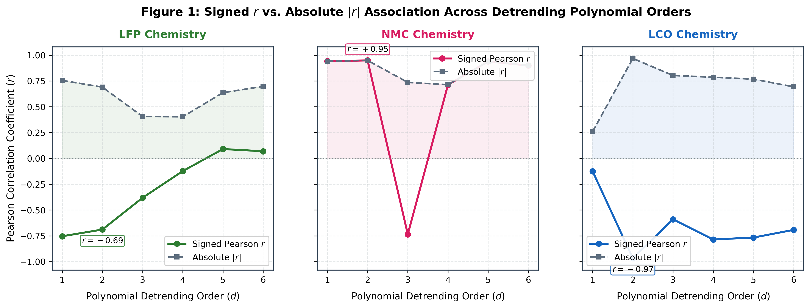

#### NMC Sign Reversal Physics

1. **OCV Curve Slope & Dynamic Variance**: NMC features a steep Open-Circuit Voltage ($OCV$) slope across 3.0V–4.2V. As internal impedance grows during aging, voltage variance ($\sigma_V$) and low-order polynomial residual variance expand rapidly.
2. **LFP Voltage Plateau**: LFP features a flat two-phase plateau ($LiFePO_4 \leftrightarrow FePO_4$) near 3.3V, where voltage shifts during discharge are minimal until steep cliff drop-off, suppressing low-degree residual growth.
3. **Kurtosis Unification**: While ripple direction reverses sign in NMC, `voltage_kurtosis` exhibits a **monotonically consistent degradation signature across all three chemistries**.

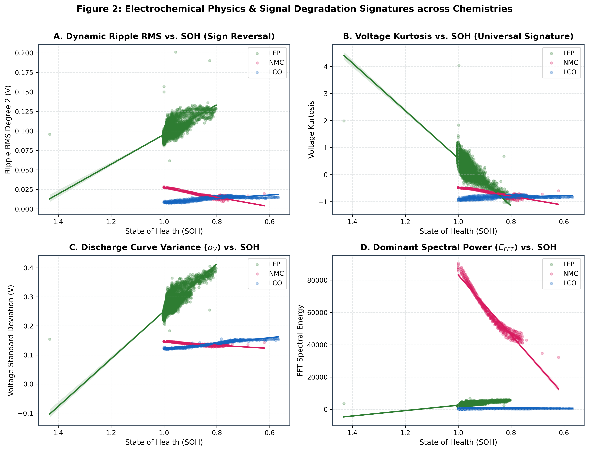

---

### 3. Experiment 3 & 4: Chemistry Interaction Statistics & Strategy Comparison

#### Interaction Analysis (ANOVA)

Nested linear regression models ($SOH \sim R_{\text{norm}}$ vs. $SOH \sim R_{\text{norm}} \times \text{Chemistry}$) yield an ANOVA **$F$-statistic of $6,364.57\ (p < 0.0001)$**:
- **Model 1 (Simple $SOH \sim R_{\text{norm}}$)**: $R^2 = 0.3161, AIC = -30786.6$
- **Model 2 (Additive $SOH \sim R_{\text{norm}} + \text{Chemistry}$)**: $R^2 = 0.6226, AIC = -36560.5$
- **Model 3 (Interaction $SOH \sim R_{\text{norm}} \times \text{Chemistry}$)**: $R^2 = 0.8367, AIC = -44695.7$
- Interaction Coefficient $\beta = +163.77\ (t = 112.72, p < 0.0001)$, proving that the dynamic slope is statistically chemistry-dependent.

#### 3-Strategy Benchmark Results (GroupKFold Cell-Level Splitting)

| Target | Chemistry | Strategy A (Global) RMSE | Strategy B (Specific) RMSE | Strategy C (Calibrated) RMSE | Strategy A $R^2$ | Strategy B $R^2$ | Strategy C $R^2$ |
| --- | --- | ---: | ---: | ---: | ---: | ---: | ---: |
| **SOH** | **LFP** | 0.0099 | **0.0095** | 0.0286 | 0.8597 | 0.8652 | −0.1036 |
| **SOH** | **NMC** | 0.0161 | **0.0078** | 0.0614 | 0.9273 | 0.9832 | 0.1273 |
| **SOH** | **LCO** | 0.0295 | **0.0285** | 0.0899 | 0.9025 | 0.9106 | 0.1327 |
| **RUL** | **NMC** | **657.8** | 684.0 | 1899.4 | 0.8925 | 0.8896 | 0.2723 |
| **RUL** | **LCO** | 133.6 | **82.5** | 216.2 | 0.0604 | 0.7270 | −0.8501 |

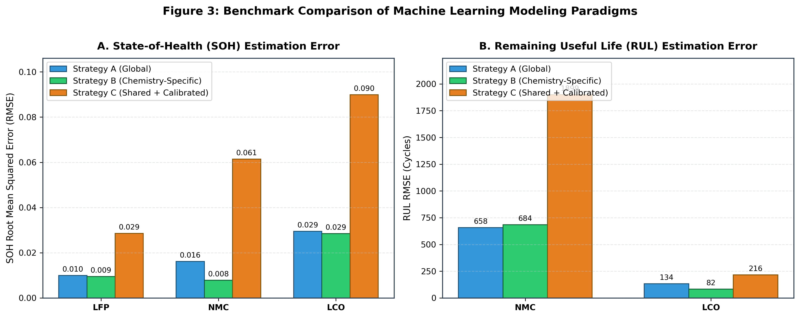

---

### 4. Single-Feature LOCO Transferability Hierarchy

Testing each feature individually in Leave-One-Chemistry-Out (LOCO) cross-validation:

#### SOH LOCO Mean RMSE (Lower is better transfer)

1. `voltage_kurtosis` — **0.0722** (Conventional Statistical)
2. `ripple_rms_deg2` — 0.0995 (Physics Ripple)
3. `ripple_norm_deg2` — 0.1026 (Physics Normalized)
4. `D2_ripple` — 0.1171 (Physics Residual Integral)
5. `fft_energy` — 0.1334 (Spectral Energy)
6. `cycle_index` — 0.1502 (Naive Baseline)
7. `spectral_entropy` — 0.1627 (Spectral Complexity)

#### RUL LOCO Mean RMSE (NMC $\leftrightarrow$ LCO)

1. `voltage_mean` — **1993.5** cycles (Conventional Mean)
2. `fft_energy` — **2063.8** cycles (Physics Spectral Energy)
3. `voltage_kurtosis` — 2124.6 cycles (Conventional Statistical)
4. `ripple_rms_deg2` — 2166.8 cycles (Physics Ripple)
5. `spectral_entropy` — 2217.5 cycles (Spectral Complexity)
6. `ripple_norm_deg2` — 2289.8 cycles (Physics Normalized)
7. `cycle_index` — 4419.6 cycles (Naive Baseline — Fails completely)

| SOH LOCO Heatmap | Feature Transfer Ranking |
| :---: | :---: |
| 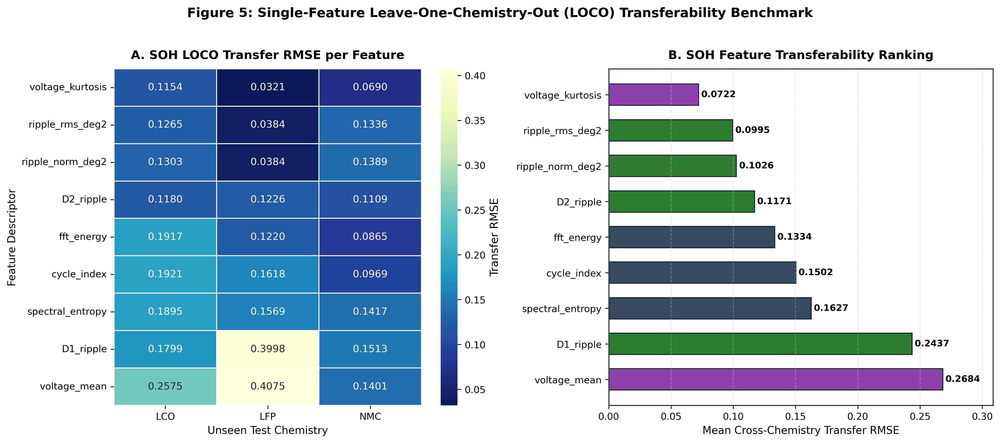 | 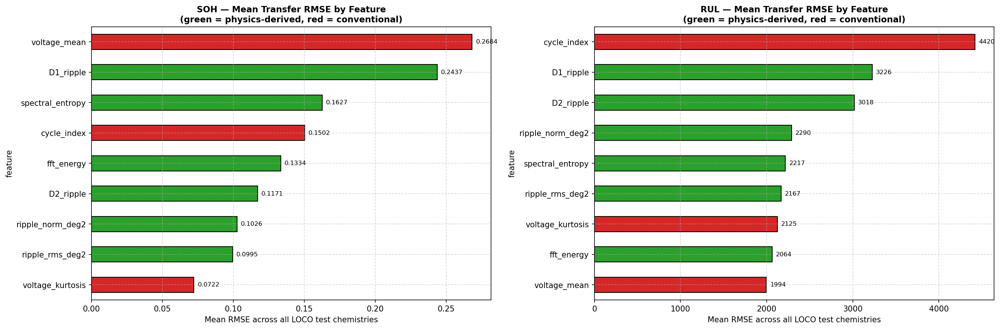 |

---

### 5. Feature Importance Ablation

Analyzing feature importances in the combined B4 Random Forest model:
- **SOH Predictors**: `voltage_kurtosis` dominates feature importance (~63%), followed by `temperature_std` (~9%) and `discharge_duration_s` (~5%).
- **RUL Predictors**: `fft_energy` dominates RUL feature importance (~65%), followed by `voltage_skewness` (~6%) and `discharge_duration_s` (~6%).

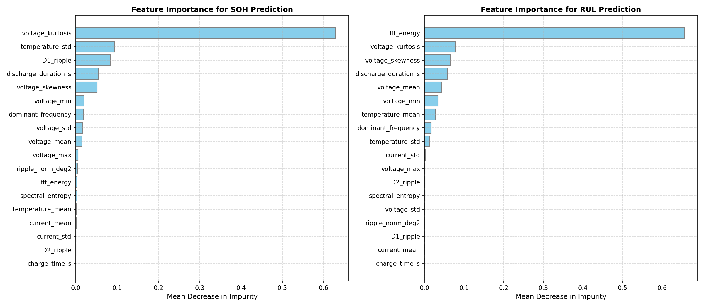

---

### 6. Chemistry Verification & Sensitivity Figures

Representative single-cell verification figures provide high visual clarity, while complete multi-cell grid figures are preserved in `bip/docs/image/` for full reference:

| Chemistry / Analysis | Representative Single Cell Figure | Complete Multi-Cell Grid (Reference) |
| --- | :---: | :---: |
| **LFP (Severson)** | 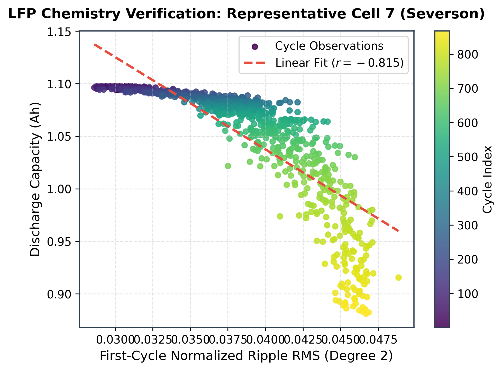 | [Full 8-Cell Grid](bip/docs/image/lfp_verification.png) |
| **NMC (Oxford)** | 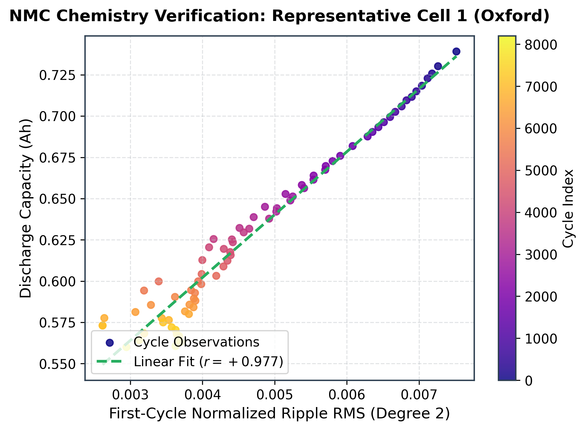 | [Full 8-Cell Grid](bip/docs/image/nmc_verification.png) \| [Outliers](bip/docs/image/nmc_outlier_investigation.png) |
| **LCO (NASA Ames)** | 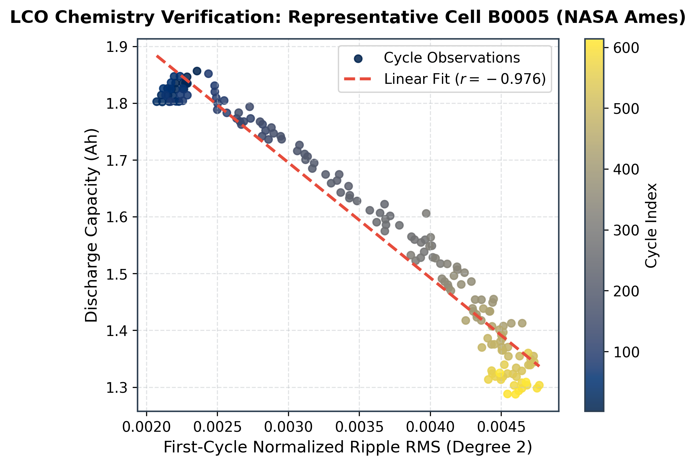 | [Full 4-Cell Grid](bip/docs/image/lco_verification.png) |

#### Polynomial Detrending Sensitivity Study (Orders 1–6)

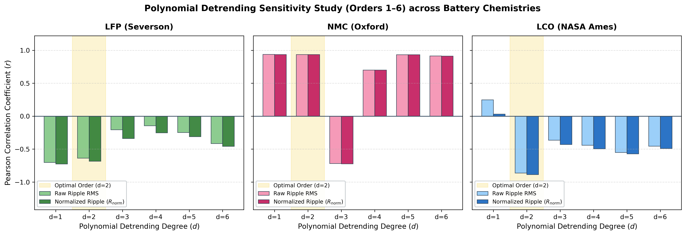

---

## Project Architecture Overview

The platform architecture is a layered, decoupled system designed for clarity, extensibility, and embedded performance:

```text
                           +----------------------+
                           |     YAML Config      |
                           +----------+-----------+
                                      |
                                      v
+------------------------------------------------------------------+
|                    Configuration Manager                         |
+------------------------------------------------------------------+
         |              |               |               |
         v              v               v               v

+----------------+  +----------------+  +----------------------+  +----------------+
| Data Ingestion |  | Physics Engine |  | Intelligence Engine |  | Deployment     |
+-------+--------+  +-------+--------+  +----------+-----------+  +--------+-------+
        |                   |                      |                      |
        v                   v                      |                      |
+-----------------------------------------------------------------------+
|                 Signal Processing Engine                              |
+-----------------------------+-----------------------------------------+
                              |
                              v
+-----------------------------------------------------------------------+
|                  Feature Engineering Engine                           |
+-----------------------------+-----------------------------------------+
                              |
                              v
+-----------------------------------------------------------------------+
|                  Dataset / Feature Store                              |
+-----------------------------+-----------------------------------------+
                              |
                              v
+-----------------------------------------------------------------------+
|                     Model Training Pipeline                           |
+-----------------------------+-----------------------------------------+
                              |
                              +-----------------------+
                              |                       |
                              v                       v
                     +----------------+     +----------------------+
                     | Validation     |     | Benchmark Framework  |
                     +--------+-------+     +----------+-----------+
                               \                    /
                                \                  /
                                 v                v
                         +----------------------------+
                         |       Model Registry       |
                         +--------------+-------------+
                                        |
                 +----------------------+----------------------+
                 |                                             |
                 v                                             v
      +----------------------+                    +-----------------------------+
      | Deployment Engine    |                    | Research Dashboard Layer    |
      +----------+-----------+                    | bip_api  (FastAPI REST)     |
                 |                                | dashboard (Vite + React 18) |
      +----------+-----------+                    | ECharts • TanStack Query    |
      |                      |                    | Zustand • TypeScript        |
      v                      v                    +-----------------------------+
+--------------+     +----------------------+
| emlearn      |     | TensorFlow Lite Micro|
+------+-------+     +----------+-----------+
       |                         |
       +------------+------------+
                    |
                    v
          +------------------------------+
          | STM32 Firmware Platform      |
          | HAL • CMSIS • ADC • DMA      |
          | UART • FreeRTOS (Future)     |
          +------------------------------+
```

---

## Repository Structure

```text
battery-intelligence-platform/
├── README.md                      # Platform overview & research findings
├── requirements.txt               # Python dependencies (ML stack + API server)
├── pyproject.toml                 # Build system & package metadata configuration
├── setup.py                       # Package discovery & installations
├── LICENSE                        # Proprietary Copyright & IP protection notice
│
├── bip/                           # Core Python library & modules
│   ├── config.py                  # YAML configuration manager
│   ├── physics.py                 # Polynomial detrending & electrochemical physics engine
│   ├── signal.py                  # Filtering & spectral analysis
│   ├── features.py                # Feature extraction & importance ablation
│   ├── models.py                  # Random Forest, SVR, and TinyML intelligence pipelines
│   ├── validation.py              # GroupKFold & LOCO cross-validation framework
│   ├── store.py                   # Dataset artifact management
│   ├── deploy.py                  # STM32 C-header export generator
│   ├── classification_artifacts/  # Master CSVs & benchmark results (11 artifacts)
│   └── docs/image/                # Publication-ready figures and visual artifacts
│
├── bip_api/                       # FastAPI REST backend for the research dashboard
│   ├── main.py                    # FastAPI app entry point (CORS, router registration)
│   ├── config.py                  # Paths & allowed CORS origins
│   ├── routers/                   # API route handlers
│   │   ├── overview.py            # /api/v1/overview/* — health check & platform summary
│   │   ├── artifacts.py           # /api/v1/artifacts/* — CSV artifact endpoints
│   │   └── deployment.py          # /api/v1/deployment/* — STM32 model registry
│   ├── schemas/                   # Pydantic v2 request/response models
│   └── services/                  # Business logic layer
│       ├── artifact_service.py    # CSV loader with in-process cache (11 artifacts)
│       └── deployment_service.py  # STM32 export directory reader
│
├── dashboard/                     # Vite + React 18 + TypeScript research dashboard
│   ├── index.html                 # App shell
│   ├── package.json               # Node dependencies (ECharts, TanStack Query, Zustand)
│   ├── vite.config.ts             # Vite build config (API proxy)
│   ├── tailwind.config.js         # Tailwind theme (chemistry color tokens)
│   └── src/
│       ├── App.tsx                # Root component (QueryClientProvider + AppLayout)
│       ├── index.css              # Design system — light/dark CSS variable tokens
│       ├── api/                   # Typed fetch clients (artifacts, overview)
│       ├── features/overview/     # 13 research feature sections & workbenches
│       ├── components/
│       │   ├── layout/            # AppLayout, Sidebar, Topbar, GlobalAnalysisHeader
│       │   ├── charts/            # ECharts wrappers (heatmaps, bar charts)
│       │   └── common/            # ScientificTable, StatusBadge
│       ├── store/                 # Zustand global state (filters, dark mode)
│       └── types/                 # TypeScript interfaces matching API schemas
│
├── scripts/                       # Executable analysis & validation scripts
│   ├── ingest_severson_data.py    # Raw data loader/parser for Severson LFP dataset
│   ├── build_master_dataset.py    # Multi-chemistry dataset compiler with RUL censoring
│   ├── audit_cell_correlations.py # Canonical correlation diagnostic
│   ├── investigate_sign_reversal.py # Signed vs abs correlation & NMC physics script
│   ├── run_calibration_study.py   # Interaction stats & 3-strategy modeling benchmark
│   ├── run_feature_transfer_study.py # Single-feature LOCO transfer study
│   ├── split_verification_figures.py # Clean representative single-cell figure generator
│   ├── run_sensitivity_study.py   # Polynomial detrending order sensitivity study
│   ├── verify_lfp_chemistry.py    # LFP Severson verification
│   ├── verify_nmc_chemistry.py    # NMC Oxford verification
│   ├── verify_lco_chemistry.py    # LCO NASA Ames verification
│   ├── run_cell_lifetime_classification.py # Embedded classifier trainer
│   ├── export_all_chemistry_models.py # SOH model TinyML exporter for all chemistries
│   └── ...                        # Diagnostic & helper script utilities
│
├── configs/                       # Experiment configuration YAMLs
├── data/                          # Dataset directory (see DATA.md for download instructions)
└── stm32_export/                  # Generated C/C++ inference models for STM32
    ├── cell_lifetime_model/       # LFP cycle life classifier C code
    ├── lfp_soh_model/             # LFP SOH regressor C code
    ├── nmc_soh_model/             # NMC SOH regressor C code
    └── lco_soh_model/             # LCO SOH regressor C code
```

---

## Getting Started

1. **Clone the Repository**:
   ```bash
   git clone https://github.com/Hireshkumaran-G/battery-intelligence-platform.git
   cd battery-intelligence-platform
   ```

2. **Environment Setup (Recommended: Conda)**:
   Create and activate the unified Conda environment (installs Python 3.11, all scientific/ML stack, API server, development tools, Node.js, and editable BIP package):
   ```bash
   conda env create -f environment.yml
   conda activate bip
   ```

   *Alternative (Standard Pip / Virtualenv)*:
   ```bash
   python -m venv venv
   source venv/bin/activate  # On Windows: venv\Scripts\activate
   pip install -r requirements.txt
   pip install -e .
   ```

3. **Download Datasets** (see `DATA.md` for full instructions):
   ```bash
   # Follow DATA.md to place Severson (LFP), Oxford (NMC), and NASA Ames (LCO) datasets under data/
   ```

4. **Re-compile Master Dataset**:
   ```bash
   python scripts/build_master_dataset.py
   ```

5. **Run Cross-Chemistry Studies**:
   ```bash
   # Run correlation audit
   python scripts/audit_cell_correlations.py

   # Run Experiments 1 & 2 (sign reversal & physics investigation)
   python scripts/investigate_sign_reversal.py

   # Run Experiments 3 & 4 (interaction stats & strategy benchmark)
   python scripts/run_calibration_study.py

   # Run Experiment 5 (per-feature LOCO transfer study)
   python scripts/run_feature_transfer_study.py

   # Generate representative verification & sensitivity plots
   python scripts/split_verification_figures.py
   python scripts/run_sensitivity_study.py
   ```

6. **Deploy Models to STM32 Target**:
   ```bash
   # Export all chemistry SOH models to stm32_export/
   python scripts/export_all_chemistry_models.py
   ```

7. **Launch the Research Dashboard & API**:

   **Option A: Unified 1-Command Launcher (Starts Backend + Frontend)**:
   ```bash
   python scripts/launch_platform.py
   ```

   **Option B: Manual Service Startup**:
   Start the FastAPI backend:
   ```bash
   uvicorn bip_api.main:app --reload --host 0.0.0.0 --port 8000
   ```
   *Interactive API docs available at `http://localhost:8000/docs`.*

   In a separate terminal, start the Vite dashboard frontend:
   ```bash
   cd dashboard
   npm install
   npm run dev
   ```
   *Dashboard available at `http://localhost:5173`.*

---

## License

This project is proprietary and confidential. See `LICENSE` for details.